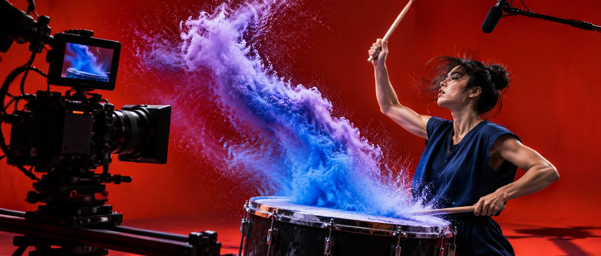

# MaxVideoAI

MaxVideoAI is a pay-as-you-go, multi-model AI video generator with tools for images and audio. Start with a prompt or a product photo, choose a model and see the price before you generate.

[Create an AI video](https://maxvideoai.com/app?utm_source=github&utm_medium=repository&utm_campaign=maxvideoai_product&utm_content=hero_try) · [See pricing](https://maxvideoai.com/pricing) · [Watch a 28-second MaxVideoAI film](https://maxvideoai.com/video/kling-4-character-reference-the-next-one)



*Pigment Stage.* A campaign still created with ImageGen.

## Watch a video made with MaxVideoAI

In *The Next One*, two strangers meet in a tram doorway. The same two faces appear across five shots, from the platform to an imagined morning in a kitchen. The film page includes the 28-second Kling 4.0 result and the prompt that assigns a separate portrait to each character. [Watch The Next One and read the shot directions](https://maxvideoai.com/video/kling-4-character-reference-the-next-one)

In the Create walkthrough, a drummer and a cloud of blue pigment are the starting brief. Selecting Wan 3 for a five-second, 720p, 16:9 take with audio showed **$0.65 USD** on November 28, 2026. The recording stops at the price. Open Create for the current price of your own settings. [Watch the 14-second MaxVideoAI walkthrough](docs/media/campaign/create-video-walkthrough.mp4)

## What does the MaxVideoAI workspace bring together?

| Where to work | How to take a shot from brief to result |
| --- | --- |
| [Create](https://maxvideoai.com/app) | Choose the model yourself, enter a prompt, add supported references and review the price before launching from the web. |
| [Studio](https://maxvideoai.com/studio) | Develop the brief with Milo, work from media in your Library and arrange finished clips on the timeline. |
| An assistant | [Install the official ChatGPT plugin](https://chatgpt.com/plugins/plugin_asdk_app_6af7c45d28c48191982cf5be6eb7e058), [connect Claude through MCP](https://maxvideoai.com/integrations/claude) or [set up Codex](https://maxvideoai.com/integrations/codex). Use the same MaxVideoAI account for quotes, credits and finished work. |

## What can you make with MaxVideoAI?

Generate a video from text, animate a still, create images for a storyboard or add audio to a sequence. To see how a shot was made, open a video in the examples gallery. Its page shows the prompt, model and available settings, along with a price estimate for recreating the setup. [Browse AI video examples](https://maxvideoai.com/examples)

## Turn a city car into a supercar

| Before · a worn sage-green city car | After · a bright orange sports coupe |
| --- | --- |
|  |  |

Look at the driver’s elbow resting on the open window and the shutter behind her. The worn hatchback gives way to a low orange coupe with wide fenders, dark open-spoke wheels and a bucket seat. Both images were created with ImageGen for this README, using the first as the reference for the second.

For your own product photo, try a new lighting setup in MaxVideoAI and compare the edit with the original. [Open Product Photo Editor](https://maxvideoai.com/tools/product-photo-editor)

If your starting material is a video, choose a passage from one continuous shot, describe the change in lighting or style and compare both clips in motion. Check lettering and product details across the full passage. [Edit a product video](https://maxvideoai.com/tools/product-video-editor)

## How do you compare current AI video models?

Choose the workflow first. A text-to-video model can start from a description. To animate the driver in the orange coupe, look for an image-to-video mode that accepts your starting frame. The directory lists the modes and inputs for each model. [Compare current models](https://maxvideoai.com/models?utm_source=github&utm_medium=repository&utm_campaign=maxvideoai_product&utm_content=models)

| What to compare | How to make it a fair test |
| --- | --- |
| Inputs and movement | Give both models the same frame and camera instruction. Check whether each supports the reference and motion controls you need. |
| Output and price | Match duration, resolution, aspect ratio and audio settings wherever both support them. If one offers only a longer take, include the cost of the full take you would have to buy. |
| Image quality | Look at the details that matter to the shot, such as the driver’s face, wheel shape or motion between frames. Inspect examples alongside the specifications. |

The comparison hub includes matchups such as Wan 3 versus Wan 3 Prime, with model capabilities, editorial assessments and examples. Use the live pages when you choose a model or check a price. [Compare Wan 3 and Wan 3 Prime](https://maxvideoai.com/ai-video-engines/wan-3-vs-wan-3-prime) · [All side-by-side comparisons](https://maxvideoai.com/ai-video-engines)

## How do project pricing and approval work?

MaxVideoAI lets you generate AI video with prepaid credits and review the price before you start. No subscription is required. [How pay-as-you-go video works](https://maxvideoai.com/pay-as-you-go-ai-video-generator)

For a sequence, list the shots, duration, references and audio needs. Ask the assistant to estimate the whole sequence with one model, then price a second version using a different model for the demanding shot. This gives you two project budgets before you commit to a take. [Project budgeting example](https://github.com/camgraphe/maxvideoai-plugin/blob/main/examples/price-a-video-project.md)

```text
Plan three shots: the driver at the window, a close-up of the wheel,
and a wide view of the parked car. Compare the cost of one take per shot
with the cost of adding a second take of the wheel. Show the assumptions.
```

Once you select a shot, the assistant prepares an exact quote for its model, inputs and settings. Your explicit approval authorizes one paid attempt. If you change the request, review the new quote. In Studio, Milo assistance credits are accounted for separately from the quote for generating media. [AI video pricing](https://maxvideoai.com/pricing) · [Studio pricing and approval](https://maxvideoai.com/studio)

## What can you prepare before generation?

| Starting material | Next step | Tool |
| --- | --- | --- |
| A still with the right subject but the wrong viewpoint | Adjust the camera angle, choose a new view and use that still as the opening frame of a video. | [Angle](https://maxvideoai.com/tools/angle) |
| A recurring character | Save the identity and create another look. In Recast, select a passage from a motion-reference clip to guide the performance. | [Character Studio and Recast](https://maxvideoai.com/tools/character-builder#recast) |
| A clip with dialogue | Transcribe speech, correct the words and timing, then download SRT or VTT subtitles or export the captioned video. | [Video subtitles](https://maxvideoai.com/tools/subtitles) |
| Several shots and a brief | Work through the prompt with Milo, add references from your Library and arrange ready clips and audio on the Studio timeline. | [Explore Studio](https://maxvideoai.com/studio) |

## How do references and continuity work?

The model and mode determine which references a shot can use. An image can establish the first frame, a video can supply movement for Recast, and a voice recording can guide a lip-sync workflow. Check the supported input types, counts and limits before choosing a model. Reuse the same owned image from your MaxVideoAI Library when the next shot needs the same character or object. [Reference-to-video guide](https://github.com/camgraphe/maxvideoai-plugin/blob/main/examples/reference-to-video.md) · [Production tools](https://maxvideoai.com/tools)

Completed media returns to the Library of the connected account. If an assistant reply stops after you approve a generation, ask for the status of the accepted job or for your recent generations. Recover a completed result there. If the job was refunded, any replacement requires a fresh quote and approval. [Open your Library](https://maxvideoai.com/app/library) · [Recover an accepted generation](https://github.com/camgraphe/maxvideoai-plugin/blob/main/examples/recover-a-generation.md)

## Which assistants, agents and automations can use MaxVideoAI?

**ChatGPT has a published MaxVideoAI plugin.** Select **Install plugin** in the ChatGPT directory and connect the MaxVideoAI account whose credits and Library you want to use. The listing includes image and video creation, voices and sound effects, characters, Recast, Studio editing and subtitles. [Install MaxVideoAI in ChatGPT](https://chatgpt.com/plugins/plugin_asdk_app_6af7c45d28c48191982cf5be6eb7e058)

Try a planning request before uploading a reference.

```text
I want to turn a product photo into a five-second video.
Compare two models that can start from my photo. Keep the camera still
and show me the price before I choose.
```

**Claude connects by custom remote MCP.** In Claude’s connector settings, add `https://api.maxvideoai.com/mcp`, choose **Connect** and authorize your MaxVideoAI account. The documented Claude Web Free check covered model discovery, a quote and recovery of an existing result. [Claude setup and tested scope](https://maxvideoai.com/integrations/claude)

**Codex** uses the tagged MaxVideoAI package. Install it, start a new task and use `$maxvideoai:plan` to compare models. Use `$maxvideoai:generate` to prepare a quote for a specific shot. Approval covers one attempt. [Codex setup and first request](https://github.com/camgraphe/maxvideoai-plugin/blob/v0.3.8/docs/codex.md)

| Other connections | Where to start |
| --- | --- |
| Another MCP client | Use an OAuth-capable client with remote Streamable HTTP support. The [MCP Registry record](https://registry.modelcontextprotocol.io/v0.1/servers/com.maxvideoai%2Fmaxvideoai/versions/latest) gives the generic endpoint and transport. |
| OpenClaw | The tested connection has limits on private references and inline channel rendering. [OpenClaw setup](https://maxvideoai.com/integrations/openclaw) |
| Self-hosted n8n | Configure the tested MCP Client workflow manually. [n8n setup](https://maxvideoai.com/integrations/n8n) |

[Assistant integrations](https://maxvideoai.com/mcp?utm_source=github&utm_medium=repository&utm_campaign=maxvideoai_product&utm_content=plugin_callout) · [MCP technical reference](https://maxvideoai.com/docs/mcp) · [Plugin repository](https://github.com/camgraphe/maxvideoai-plugin) · [Plugin releases](https://github.com/camgraphe/maxvideoai-plugin/releases)

## How is MaxVideoAI built?

The web application uses Next.js App Router, React, TypeScript and Tailwind CSS. Supabase Auth handles sign-in, Neon Postgres stores application data, Amazon S3 stores media and Stripe handles billing. Server-side adapters submit jobs to model providers. The assistant integrations use remote Streamable HTTP MCP and OAuth.

| Repository area | Responsibility |
| --- | --- |
| [Routes](frontend/app), [components](frontend/components) and [shared libraries](frontend/lib) | Workspace, public pages, APIs and product UI |
| [Server orchestration](frontend/server) and [execution](frontend/src/server) | Provider adapters, jobs, billing and MCP |
| [Model registry](frontend/config/model-registry.json) | Model identity and publication |
| [Plugin source](plugins/maxvideoai) | Manifests, skills, setup guides, release assets |
| [Migrations](neon/migrations) | Application database schema |

Read the [architecture guide](docs/engineering/project-structure.md), [model registry workflow](docs/engineering/model-registry.md), [MCP mode coverage](docs/engineering/mcp-mode-coverage.md) and [reference-import guide](docs/engineering/mcp-reference-imports.md) for the corresponding contracts.

## Local development

Use Node.js 22 and the pnpm version pinned in this repository.

```bash
pnpm install
cp frontend/.env.local.example frontend/.env.local
pnpm dev
```

Use these checks for GitHub content and asset changes.

```bash
pnpm github:content:check
pnpm github:assets:check
pnpm github:score -- --require-after
npm run lint:exposure
git diff --check
```

The [local development guide](docs/engineering/local-development.md) covers setup, migrations and validation, including Playwright browser checks. Consult the [environment reference](docs/engineering/environment-reference.md), [agent guide](AGENTS.md) and [working guide](docs/engineering/llm-working-guide.md) before changing application behavior.

## Contributing, security, and license

| Need | Destination |
| --- | --- |
| Contribute a change | [Contributor guide](CONTRIBUTING.md) and [public/private boundaries](docs/public-vs-private.md) |
| Report a vulnerability privately | [Security contact](mailto:security@maxvideoai.com) |
| Get product support | [Contact MaxVideoAI](https://maxvideoai.com/contact) |
| License the code for commercial deployment | [Commercial licensing](docs/licensing/dual-license.md) and [licensing enquiries](mailto:licensing@maxvideo.ai) |

The source is licensed under the [Business Source License 1.1](LICENSE). Its use grant and change date are in the license file. See the [notices](NOTICE) for additional terms.
