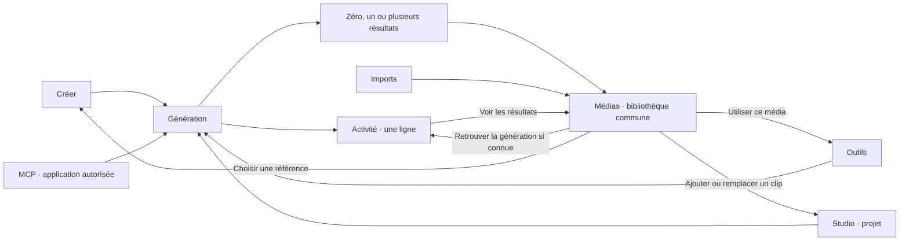

# Médias, Activité et parcours de création

Proposition interactive du 10 novembre 2026, fondée sur le main `86b598f8`.
Les parcours décrits comme simulés sont locaux. Aucun nouveau contrat serveur
n’est implémenté par cette proposition.

## Deux rôles distincts

**Médias répond à « où est mon fichier et que puis-je en faire ? »** La bibliothèque
réunit images, vidéos et audio, imports et résultats, en conservant leurs identités.
Elle sert au repérage visuel, aux collections, favoris, téléchargement, corbeille,
sélection de références et réutilisation dans les outils.

**Activité répond à « qu’ai-je lancé, où en est-ce et comment le reprendre ? »**
Une ligne représente une génération, avec état, opération/modèle connu, extrait
du prompt, date, origine et accès aux résultats. Aucun lecteur ni grande vignette
dans la liste. Les détails et les actions secondaires apparaissent à la demande.
Les montants, remboursements et informations d’erreur utiles restent dans le
détail lors de l’intégration, sans alourdir chaque ligne.

Une génération peut produire zéro, un ou plusieurs médias. Un import n’a pas
nécessairement de génération. Supprimer un historique et placer un média dans la
corbeille sont deux opérations différentes. Un résultat manquant ou supprimé
n’efface pas silencieusement l’événement historique.

## Parcours testables dans la maquette

| Point de départ | Action | Résultat local |
| --- | --- | --- |
| Activité · Storyboard | Voir les 2 médias | Bibliothèque limitée aux deux sorties existantes, sans copie ; retour vers Activité et retrait du contexte. |
| Fiche d’un média généré | Retrouver la génération | Détail de l’opération associée. Un import affiche l’absence de génération. |
| Activité · génération Créer ou MCP | Reprendre dans Créer | Brouillon avec le prompt et le modèle connus. Les sorties ne deviennent pas automatiquement les références d’entrée. |
| Activité · outil | Reprendre dans l’outil | Panneau de reprise avec le prompt et les résultats précédents identifiés comme tels. |
| Fiche d’une image | Créer une vidéo / image | Image exacte ajoutée au brouillon comme référence ; modèle à choisir. Le panier existant est conservé dans sa limite de démonstration. |
| Fiche d’un média | Outil compatible illustré | Panneau montrant le média choisi ; aucune génération déclenchée. |
| Fiche d’un média | Studio | Choix du film et ajout en fin/remplacement d’un clip simulés. |
| Activité · origine Studio | Ouvrir le projet | Contexte du projet associé, sans insertion automatique des résultats. |
| Activité · origine MCP | Filtrer / détail / résultat / reprise | Même génération et mêmes médias que les interfaces web ; aucune seconde bibliothèque ni lien inventé vers une conversation externe. |
| Activité en cours ou en échec | Détails | État explicite et aucun faux résultat ; reprise proposée seulement hors génération en cours. |

Les états, origines et relations sont des fixtures. Les filtres de la liste
restent en mémoire lorsqu’on ouvre les résultats puis revient. Les listes sont
affichées par fenêtres de 24 lignes ; les filtres couvrent uniquement le jeu
fictif chargé en mémoire, pas une API de production.

## Propriétaires actuels et intégration à réaliser

| Responsabilité | Contrat actuel à réutiliser / travail restant |
| --- | --- |
| Activité web | Route `/jobs`, `JobsPageShell.tsx`, groupes `GroupedJobCard`, `useInfiniteJobs` et guide `activity-feed.md`. Remplacer la présentation des groupes par des lignes en conservant pagination, rafraîchissement, compte, erreurs, sauvegarde et suppression d’historique. Le filtre d’état actuel porte sur les pages chargées : ne pas présenter un filtre global sans nouveau contrat serveur. |
| Résultats dans Médias | Les rendus récents existent déjà dans `LibraryPageClient`. `resolveLibraryEntry` et `useLibraryPageData` acceptent déjà `view=review&kind=…&job=…`, avec un périmètre `jobId` dans la recherche ; le contrat est couvert pour les cartes de résultat MCP. Réutiliser ce lien depuis Activité avec les sorties exactes et identités canoniques appartenant au compte. Ne pas créer un média enregistré supplémentaire juste pour ouvrir cette vue, ni traiter un tableau arbitraire d’IDs comme une preuve d’autorisation. |
| Reprise d’une génération | `jobs-page-helpers.ts` choisit la surface et le lien `?job=`. Réutiliser l’orchestration de restauration existante : moteur, mode, paramètres et références d’origine. Le prototype n’en restaure que le prompt/modèle fictifs ; l’intégration doit conserver les gardes de données manquantes, de réponse périmée et de devis courant. |
| Média vers outil | `media-handoff.ts` et `MediaDestinationActions` portent la destination, les capacités, l’original exact, l’isolation de compte, le jeton à usage unique et son expiration. La liste illustrée dans la maquette n’est pas une matrice exhaustive de capacités. Les actions réelles doivent venir du propriétaire commun, y compris Modify/Extend et les outils Creator publiés. |
| Sélecteur dans Créer/outils | Réutiliser le sélecteur partagé et les contrats livrés par la PR 638 : sélection directe, aperçu distinct, lot ordonné, remplacement ciblé, contrôle des capacités, accès privé, pagination et original exact. La capacité fictive de 10 images ne vaut pas pour tous les modèles. |
| Studio | `StudioMediaAction.client.tsx` résout le média, charge les films et la timeline, puis applique un ajout/remplacement avec révision et idempotence. Conserver durée/placement, résolution canonique, changement de version du film et reprise de la même modification. Ouvrir un projet et modifier sa timeline restent deux actions distinctes. La route de film actuelle est `/app/studio/conversation/[projectId]`. |
| Origine MCP / Studio | `quote-repository.ts` distingue `auth_origin`, `oauth_client_id` et `studio_project_id`. Projeter une origine seulement depuis une relation serveur prouvée avec le job appartenant au compte ; ne pas la deviner depuis le nom, le modèle ou le média. Les anciens événements sans origine fiable restent non renseignés. |
| Historique MCP | `activity-history.ts` expose 20 événements de devis avec application, modèle et résultat, mais sans IDs de sortie ni lien de projet dans son DTO. Une préparation/expiration de devis n’est pas une génération. Ne pas fusionner naïvement cette liste avec `/jobs`, ni compter préparation et confirmation deux fois. Conserver le journal d’intégration spécialisé et exposer seulement les exécutions acceptées dans le journal des générations. |
| Liens depuis MCP | `buildAgentGenerationDestination` fournit déjà la surface vidéo/image/audio avec `?job=` sur un domaine de compte autorisé. Conserver ces points d’entrée et le filtre de bibliothèque testé par `workspace-library-page-architecture.test.ts`. Il reste à projeter l’origine de façon fiable dans le journal web ; un lien vers MaxVideoAI n’implique pas qu’un retour vers la conversation du client MCP existe. |
| Source et détails | Liaison autorisée job/output/asset, détail chargé à la demande. Respecter masquage, suppression, accès signé et annulation au changement de compte/sélection. Un média conservé après retrait de l’historique reste utilisable ; masquer le lien de source devenu indisponible. |

## Conditions de passage au produit

Avant intégration : spécifier la projection d’origine et les liens job/output,
définir le périmètre des filtres/recherches paginés et réutiliser les propriétaires
de restauration, destination et Studio. Ne pas remplacer ces propriétaires par
les fixtures ou les panneaux simulés.

Vérifier les chemins Créer, images, audio, outils et MCP avec un compte autorisé ;
les sorties multiples, résultats absents, générations échouées, imports, historique
retiré, média à la corbeille et projet révisé ; la reprise complète des réglages,
les capacités, l’accès privé, les états EN/FR/ES et le clavier/mobile. Le devis
doit rester explicite et aucune navigation ne doit lancer une génération payante.

Les tests navigateur hébergés de cette proposition vérifient les relations
synthétiques et l’ergonomie. Ils ne certifient pas ces parcours authentifiés.
