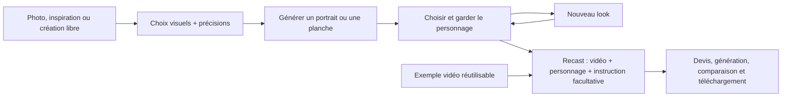

# Character Studio — audit d’usage et comparaison concurrentielle

Date : 3 novembre 2026. Branche : `codex/character-studio-v2`.
Périmètre : éditeur réel `/app/tools/character-builder`, Higgsfield AI Influencer,
Pollo AI Influencer et Recast. Cet audit complète la proposition initiale ; il
décrit séparément ce qui fonctionne, ce qui manque et ce qui reste à qualifier.

## Verdict

L’éditeur visuel constitue une base cohérente : import identifiable, familles de
choix illustrées, personnalisation libre, réglages secondaires repliés et action
de génération fixe. La couverture initiale est suffisante pour créer des
personnages variés. Ajouter des dizaines de vignettes n’est pas la priorité.

Le parcours complet n’est pas encore au niveau visé. Il manque surtout une
identité sauvegardée et réutilisable, ses looks, le passage direct du résultat à
Recast et l’exécution réelle de Recast. L’interface actuelle ne doit pas être
présentée comme une livraison complète de ces fonctions.

## Ce qui a été observé chez les concurrents

Les constats d’interface ci-dessous proviennent des pages publiques consultées
dans le navigateur, sans connexion ni génération payante. Ils ne démontrent pas
la fidélité réelle des rendus. Les fonctions après génération décrites dans les
guides sont identifiées comme documentées, non testées sur un compte.

### Higgsfield

La page présente Create Influencer / Motion, l’import photo facultatif, des
rubriques visuelles, Randomize, un nombre de sorties et Generate. Explore /
History reste distinct de la configuration. Les cartes proposent View character
sheet et Recreate. Neuf types sont visibles. Le passage à Insect retire plusieurs
réglages humains, dont Ethnicity et certaines rubriques du visage ; d’autres
restent disponibles. Le sélecteur Style présente huit familles : Retro, Sporty,
Y2K, Theatre, Goth, Suits, Streetstyle, Casual. Motion utilise une vidéo de 4–30 s,
des images de référence, un prompt facultatif et une qualité.
[Interface observée](https://higgsfield.ai/ai-influencer-studio).

La documentation publique décrit un fonctionnement structuré : catalogue de
traits filtré par type, choix transmis par identifiants, photo d’identité séparée
des références de vêtements/objets, génération asynchrone d’une planche avec
portrait et vue en pied. Le catalogue expose les compatibilités et exclusions.
Cela confirme une voie technique concrète : compiler les choix et références
vers une génération d’image. Aucune prévisualisation 3D n’est nécessaire.
La seed ne garantit pas une identité pixel à pixel ; il faut conserver l’image
validée comme référence. Cette API ne prouve pas tous les détails du backend web.
[Contrat officiel](https://open.higgsfield.ai/models/higgsfield/ai-influencer/api-reference).

### Pollo

La page observée présente treize types, dix-neuf rubriques de paramètres,
Explore / History et Recreate. Un bouton Selected settings ouvre un récapitulatif
avec Reset all. Style propose dix-huit familles dans la vue consultée. Recast
accepte une vidéo de 4–30 s et jusqu’à dix images, propose Lite / Pro, un prompt
facultatif, quantité, résolution et Advanced. Les options de visibilité et
protection sont secondaires. Ce sont des capacités propres à Pollo, pas des
limites à recopier dans notre futur contrat fournisseur.
[Influencer](https://pollo.ai/ai-influencer), [Recast](https://pollo.ai/recast).

Le guide décrit les personnages enregistrés, le renommage, Re-create, New Looks
et l’entrée dans Recast directement depuis un personnage. Ce sont les étapes
qui donnent de la continuité au produit ; elles restent à valider en usage réel
chez le concurrent.
[Guide Influencer](https://pollo.ai/hub/how-to-use-pollo-ai-influencer).

Le guide Recast décrit un exemple qui recharge vidéo, références et instructions,
puis le remplacement de l’image du personnage. Il annonce aussi la conservation
de la bande-son. Notre propre politique audio devra être vérifiée sur le moteur
retenu, avec un résultat réellement lu avec le son.
[Guide Recast](https://pollo.ai/hub/how-to-use-Pollo-recast).

## Comparaison fonctionnelle et décisions

| Besoin | Character Studio actuel | Décision proposée |
| --- | --- | --- |
| Commencer sans prompt | Sept types, présentation, âge et autres traits visuels ; six inspirations | Conserver. Les inspirations sont des recettes, pas une promesse de reproduire exactement leur visage. |
| Partir d’une photo | Import et bibliothèque existants ; référence d’identité distincte de la tenue | Conserver. Montrer clairement ce qui sera préservé et quels choix le modifient. Import distant à qualifier dans un environnement connecté. |
| Couvrir l’apparence | Douze coiffures, six formes d’yeux, couleurs libres, huit styles, silhouette, accessoires et détails | Couverture de départ raisonnable. Ajouter seulement les manques révélés par les usages, pas le catalogue entier d’un concurrent. |
| Personnages non humains | Animal, insecte, fruit, extraterrestre et description libre | Adapter les libellés et options au type. Le prompt conditionnel actuel ne suffit pas à rendre l’interface cohérente. |
| Tenue et décor libres | Texte de tenue, référence de tenue, vingt-quatre décors et texte de décor | Conserver les familles génériques. Faire comprendre « remplacer les choix » versus « compléter un décor ». |
| Comprendre les choix actifs | Résumés par rubrique, mais incomplets ; aucun récapitulatif transversal | Ajouter un récapitulatif compact modifiable, sans rouvrir toutes les rubriques. |
| Valider l’identité | Portrait ou planche générée via la chaîne image existante | Une fois un résultat choisi, proposer explicitement « Garder ce personnage ». Une vignette de catalogue ne devient jamais cette identité. |
| Reprendre plus tard | Brouillon local par compte, images et réglages des jobs | Ajouter les personnages nommés et leurs looks durables. L’historique d’images n’est pas cette bibliothèque. |
| Changer de tenue | Modification du brouillon et nouvelle génération | Créer un mode Nouveau look à partir de l’image validée ; ne pas reconstruire l’identité depuis les seuls traits. |
| Passer en vidéo | Recast séparé, brouillon local uniquement ; actions média existantes selon disponibilité des outils | Ajouter un passage direct avec le personnage déjà choisi. Recast ne doit pas rouvrir les réglages de look. |
| Reprendre un exemple vidéo | Aucun exemple Recast réutilisable branché | Chaque exemple doit avoir vidéo source, références, prompt et provenance exploitables. Une image décorative seule ne suffit pas. |
| Comprendre le prix | Estimation par image, quantité 1/4, blocage si tarif absent | Afficher le total correspondant à la quantité avant génération, puis conserver le reçu réel. |

## Problèmes corrigés pendant cet audit

1. **Historique trompeur.** L’état vide utilisait un message de rendu en cours.
   Le chargement, l’absence d’images et l’échec de chargement sont désormais
   distincts. L’échec expose Réessayer, sans effacer les résultats locaux déjà
   présents ni les choix. Aucun message technique brut n’est montré.
2. **Résumés incohérents.** Une tenue ou coiffure décrite librement pouvait garder
   le nom du preset dans la rubrique repliée. Elle affiche maintenant Sur mesure.
   Une couleur de cheveux seule peut aussi apparaître dans le résumé.
3. **Action hors contexte dans Recast.** Le « + » créait un nouveau personnage
   et effaçait son brouillon depuis Recast. Il est maintenant réservé au mode
   Personnage ; le changement de mode suffit pour revenir à l’éditeur.
4. **Entrée Explorer sur mobile.** Elle pouvait ouvrir Mes images si cet onglet
   était resté sélectionné. Elle ouvre désormais bien les inspirations.
5. **Erreur de bibliothèque illisible.** Mes médias affichait le code brut
   `LOAD_FAILED`. L’erreur utilise maintenant le message traduit prévu à cet effet,
   annoncé comme une alerte.

Ces corrections sont locales à l’interface et à la lecture de l’historique.
Elles n’ajoutent aucun modèle, tarif, débit, job Recast ou schéma de stockage.

## Priorités avant une livraison complète

### P0 — terminer le parcours et prouver qu’il fonctionne

- **Personnage durable et looks.** Sauvegarder un nom, une image d’identité
  validée, la recette versionnée et des looks rattachés. Retrouver la même identité
  après rechargement et sur un autre appareil. Réutiliser les propriétaires
  existants des médias, des jobs et de l’isolation par compte.
- **Recast exécutable.** Brancher les imports possédés, la validation média,
  les capacités du moteur, le devis, la réservation, le job durable, la reprise
  et les résultats. La limite de durée, les résolutions, le nombre de références
  et l’audio doivent venir du moteur réellement intégré.
- **Passage personnage → Recast.** L’image validée arrive automatiquement dans
  le champ de remplacement ; l’utilisateur fournit sa vidéo ou un exemple.
  Les nouveaux vêtements se préparent dans Nouveau look.
- **Recette complète en environnement connecté.** Vérifier génération image,
  conservation d’identité, historique, upload, téléchargement, rejet fournisseur,
  compte insuffisamment crédité et reprise après fermeture. Sans cette preuve,
  la bonne tenue de l’interface ne démontre pas un produit opérationnel.

### P1 — éviter les erreurs d’intention

- **Annulation du remplacement de brouillon.** Nouveau personnage et inspiration
  remplacent les réglages immédiatement. Prévoir Annuler avec conservation du
  brouillon précédent, sans toucher aux jobs terminés ou en cours.
- **Choix actifs explicites.** Une description de coiffure remplace les réglages,
  mais les anciennes couleurs restent visuellement cochées. Un clic couleur
  peut supprimer cette description. Rendre visibles les modes « Choix » et
  « Description », les réglages inactifs et les effets de retour aux presets.
- **Compatibilité par type.** Pour animal, fruit et alien, remplacer les libellés
  humains inadaptés par des contrôles pertinents, sans supprimer silencieusement
  les préférences. Permettre de préciser l’espèce. La description libre reste
  une échappatoire utile, pas la seule façon de comprendre un preset Animal.
- **Résumé précis.** Visage peut afficher Libre alors qu’une forme d’œil ou un
  détail est défini. Regrouper les choix actifs dans un récapitulatif compact,
  avec retrait individuel et retour à la rubrique concernée.
- **Résultats lisibles.** Les cartes héritées recadrent les images à hauteur fixe :
  une planche mérite un aperçu entier. Clarifier « Reprendre les réglages »,
  « Nouveau look » et « Recast ». Après reprise sur mobile, revenir à l’éditeur.
- **Sortie et coût visibles.** Résumer portrait/planche, qualité, format et quantité
  près du bouton, avec total courant et raison de blocage. Conserver le détail
  dans un panneau secondaire pour ne pas rallonger la page.
- **Exemples Recast utiles.** Une petite sélection de vidéos de personnes et
  mascottes, avec chargement reproductible et comparaison avant/après ; vérifier
  droits/provenance avant publication. Lecture au clic et miniature stable.
- **Bibliothèque au clavier.** Compléter la recette du dialogue : nom accessible,
  focus à l’ouverture, confinement du focus, fermeture avec Échap et retour au
  déclencheur. Le modal hérité n’apporte pas explicitement tous ces mécanismes.

### P2 — enrichir après validation du parcours

- Randomiser une sélection en gardant certains traits verrouillés.
- Ajouter des familles pertinentes à partir des demandes réelles ; les styles
  spécialisés restent accessibles par description et référence visuelle.
- Recherche et filtres dans une bibliothèque devenue suffisamment grande.
- Options de partage/protection seulement si un parcours de publication existe.

## Organisation cible : une page, trois intentions

Le haut de page reste léger : Personnage / Recast. Dans Personnage, les modes
Créer et Nouveau look se distinguent par l’identité sélectionnée. Le panneau de
droite contient Explorer, Mes personnages et l’historique des sorties. En mobile,
on bascule entre réglages et résultats avec un retour explicite ; la génération
reste accessible dans l’éditeur. La densité n’augmente pas avec les fonctions.

L’identité produit affichée est **MaxVideoAI Recast**, y compris dans les états,
résultats et transactions. Le fournisseur reste une responsabilité interne.
L’hypothèse commerciale évoquée, coût fournisseur ×2, reste à formaliser dans le
propriétaire de devis avec coûts vérifiés, arrondis, reçus et remboursements ;
elle n’est ni activée ni estimée dans cet audit.

## Validation réalisée et limites

La recette des rendus devra inclure au minimum les cas suivants. Ils ne sont pas
déclarés réussis par les tests de code :

| Scénario à générer | Critère d’acceptation visuelle |
| --- | --- |
| Personnage humain sans photo | Traits demandés reconnaissables ; visage et cheveux cadrés sans coupe accidentelle. |
| Photo d’identité + trois looks | Même personne reconnaissable ; tenue et décor changent sans dérive majeure du visage. |
| Chauve après une coiffure colorée | Pas de cheveux résiduels imposés par les anciens réglages. |
| Description de tenue remplaçant Casual | La description gouverne le rendu ; aucun vêtement contraire ajouté par l’ancien preset. |
| Décor libre sur portrait et planche | Décor demandé présent, pas de fond studio neutre concurrent. |
| Insecte, tête de fruit et alien | Concept respecté ; pas de simple humain masqué ou de membres humains imposés. |
| Couleur personnalisée des yeux/cheveux | Famille de couleur respectée sous l’éclairage ; ne pas promettre une égalité exacte des pixels avec le code hex. |
| Recast d’un sujet, puis scène à plusieurs sujets | Bon sujet remplacé, mouvement et durée cohérents, identité reconnaissable, comportement audio vérifié. |

Pour comparer la qualité aux concurrents, utiliser les mêmes références et des
instructions équivalentes, conserver tous les résultats et faire une revue
côte à côte. Une sélection de quelques belles sorties ne suffit pas.

| Contrôle | Résultat et niveau de preuve |
| --- | --- |
| Interfaces concurrentes | Pages et commandes consultées en direct ; pas de rendu comparatif payant. |
| Contrats traits → prompt → reprise | 40 tests ciblés réussis, dont types libres, scènes, couleurs, anciens réglages et isolation des comptes. |
| Résumé des textes libres | Tenue et coiffure testées dans le navigateur, rubriques repliées puis rouvertes ; choix initiaux restaurés. |
| Historique inaccessible | Échec réel observé localement, message exact et Réessayer vérifiés ; brouillon conservé. La réussite après récupération serveur n’est pas testable ici. |
| Bibliothèque de références | Ouverture et erreur locale observées ; message technique remplacé par une alerte traduite. Sélection de médias distants non validée. |
| Mobile | 390×844 : largeur du document 390, dock dans l’écran au-dessus de la navigation ; bascule réglages/images et retour testés. |
| Ordinateur peu haut | 1280×720 : largeur du document 1280, dock terminé à y=707, toujours visible pendant la lecture des réglages. |
| Recast | Changement de mode et conservation des instructions testés ; aucune action Nouveau personnage dans ce mode. Lecture/import local déjà vérifiés lors de la livraison précédente. |
| Persistance du brouillon | Réglages conservés après remontage de développement. Les tests existants couvrent comptes et réponses obsolètes. |
| Vérification statique | TypeScript sans erreur ; lint sans erreur, sept avertissements existants hors périmètre ; contrôle d’exposition réussi. |
| Génération réelle, import distant, portefeuille | Non validés : base locale et tarifs indisponibles. Aucune dépense ni génération fournisseur pendant l’audit. |
| Accessibilité et performance | Inspection des libellés, états et géométrie ; pas de certification lecteur d’écran, audit WCAG complet ou mesure comparative de Core Web Vitals. |

La prochaine tranche recommandée est **personnage sauvegardé + Nouveau look +
passage vers Recast**, avec un contrat d’identité explicite. L’intégration du
moteur vidéo et sa recette de facturation complètent ensuite ce parcours. Les
critères P0 restent nécessaires avant de revendiquer la parité fonctionnelle.
