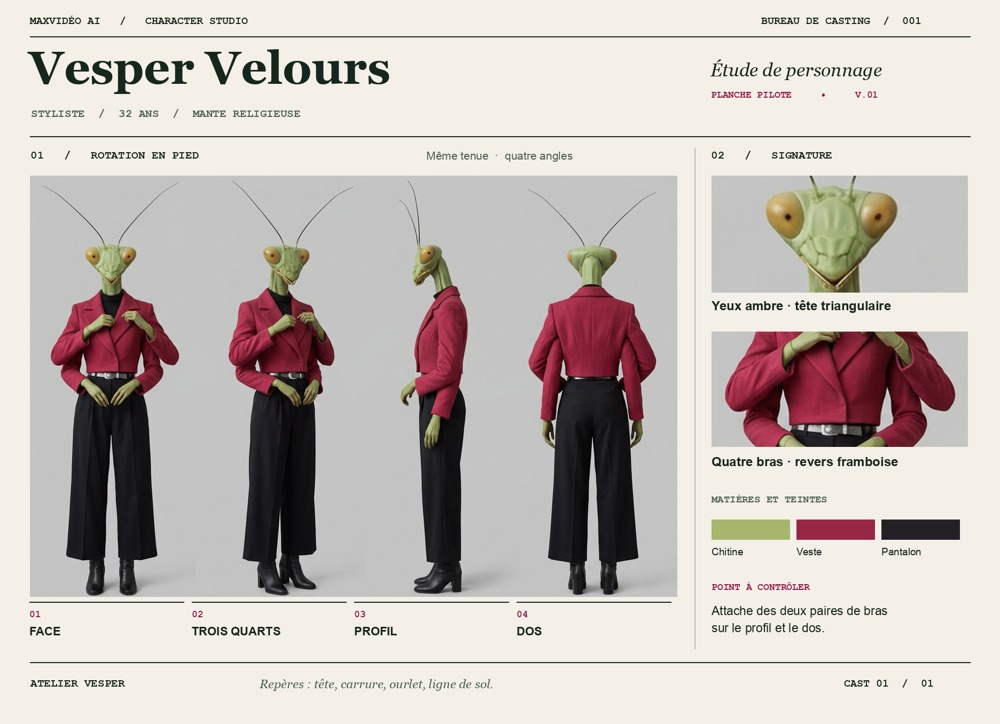
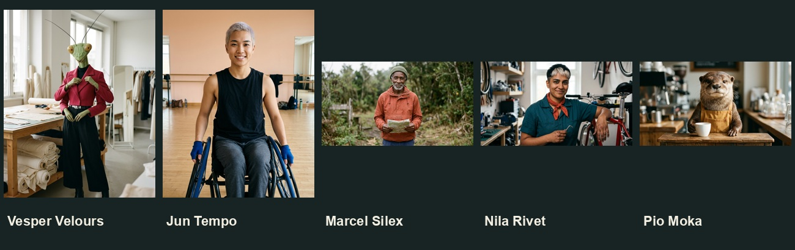

# Character Studio · revue de casting et planche pilote

Le pilote de Vesper comprend une seule génération image-to-image en 1K à partir
de son identité sauvegardée (Nano Banana 2.1). Les quatre vues sont dans le même
rendu ; les deux détails sont de vrais recadrages. Les légendes et la palette ont
été composées séparément. La vue « Planche personnage » de la bibliothèque
ouvre un brouillon avec cette identité avant toute dépense. Le lecteur affiche
l’original et la référence ; le dépliant PNG/PDF avec détails est le prototype
de direction artistique, pas un export automatique du Studio.

Face, trois quarts, profil, dos : le choix suit le [référentiel de production
EDC](https://dma.edc.org/sites/default/files/VA_Unit_5_Supplement.pdf). La ligne
de sol et les repères à hauteur constante suivent le principe de [turnaround
illustré par AK Studio](https://www.theakstudio.com/blog/creating-a-character-turnaround).
Deux détails suffisent ici : matière du visage, construction de la veste. Sur
un autre personnage on choisirait un repère propre à son identité : les mitaines
et la roue de Jun, par exemple.

L’identité, les couleurs et la silhouette sont lisibles. La vue de profil fait
face au côté opposé du trois-quarts, et les insertions des quatre bras restent
ambiguës au dos. Le modèle a aussi dessiné de petites légendes en anglais ;
elles sont remplacées dans la mise en page, pas dans l’original. Pour un usage
technique, vérifier chaque angle ; ne pas corriger un côté par miroir lorsque
le sujet est asymétrique. Ne pas généraliser le pilote avant revue.

## Films proposés — avant devis

| Créateur | Client / canal | Preuve attendue | Source |
| --- | --- | --- | --- |
| Dixie | Prof de danse / TikTok | Deux pas croisés, clap, quart de tour, boucle | Nouvelle prise verticale à tourner |
| Cole | Horloger / fiche produit | Manche relevée, rotation de poignet, bracelet et cadran stables avec voix française | Nouvelle prise à tourner ; portrait, référence produit et audio disponibles |
| Nana | Torréfacteur / recette UGC | Versement de mousse, niveaux de liquide et prise de tasse continus | Nouvelle prise à tourner |
| Bea | Marque outdoor / publicité sociale | La même gourde entre et ressort de la poche extérieure du sac | Nouvelle prise à tourner |
| Basil | Label de mode / Explorer | Le pas glissé et les figurants d’origine sont conservés, seul le meneur devient Basil | Extrait local Dandys Paris disponible |

Aucun rendu vidéo réalisé. Les visuels du pilote restent des documents de revue
et ne sont pas publiés sur les surfaces marketing.
