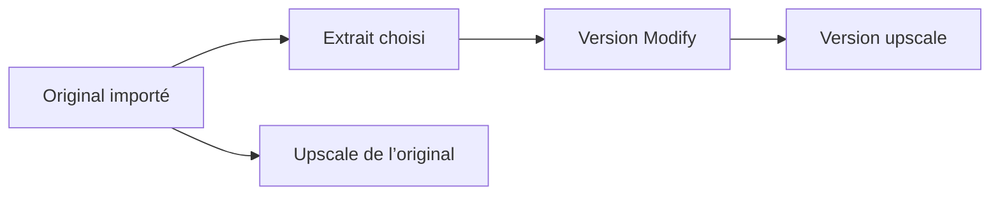

# Bibliothèque média, imports téléphone et versions : étude de faisabilité

Date : 22 octobre 2026. Statut : recommandation produit et technique, non implémentée.

Cette étude complète la [conception du parcours vidéo-vers-vidéo](2026-10-22-video-to-video-phone-import-design.md). Elle couvre imports, générations, Modify, upscaling, exports et libération d’espace. Elle s’appuie sur le code de la branche `codex/v2v-phone-import`, une inspection en lecture seule de la bibliothèque web et les documentations officielles citées. Aucun média n’a été supprimé, aucune génération payante lancée, aucune politique de production modifiée pour cette étude.

## Décision recommandée

Conserver les originaux importés et les résultats livrés dans notre propre stockage, sous un quota explicite. Organiser leurs versions dans une bibliothèque commune et permettre à l’utilisateur de choisir ce qu’il garde. Nettoyer automatiquement les fichiers de transit et les copies techniques abandonnées.

« Durable » signifie réutilisable et téléchargeable après la session, sans dépendre d’une URL fournisseur temporaire. Cela ne signifie pas stockage illimité à vie. Le quota, la conservation du compte et les éventuelles exceptions doivent être annoncés ensemble ; cette étude ne change pas les engagements existants.

Ne pas séparer physiquement les rendus de la bibliothèque pour résoudre le coût : ils occupent toujours des octets. Des filtres Imports, Créations et Upscales suffisent pour l’organisation. Les résultats payés restent des fichiers autonomes, même si leur source est supprimée ultérieurement.

## Ce que font les autres

| Service et périmètre | Pratique documentée | Choix pour MaxVideoAI |
| --- | --- | --- |
| [Runway Assets](https://help.runwayml.com/hc/en-us/articles/4408611980563-Managing-assets) et [Edit Studio](https://help.runwayml.com/hc/en-us/articles/51683104370451-Creating-with-Edit-Studio) | Bibliothèque d’imports et de créations ; source et itérations accessibles ; sélection d’une plage pour l’édition. | Un original réutilisable et des versions reliées, avec un sélecteur de passage partagé. |
| [Tarifs Runway](https://runway.com/pricing) | 5 Go gratuits, 20 Go Standard, 100 Go Pro et 500 Go Max au relevé. | Un quota de bibliothèque est distinct des crédits de génération. Ces volumes ne déterminent pas notre offre PAYG. |
| [Topaz for Web — My Files](https://docs.topazlabs.com/cloud-apps/imageweb-myfiles) | Imports et rendus améliorés regroupés ; original préservé ; comparaison et téléchargement multiple. Supprimer le fichier supprime aussi ses rendus. | Reprendre le regroupement, mais permettre de supprimer une version seule. Une suppression de groupe doit détailler tout ce qu’elle enlève. |
| [Kapwing — stockage](https://www.kapwing.com/help/cloud-storage-policy/) | Quota incluant imports, créations IA et versions optimisées ; avertissement à 90 %, imports bloqués à 100 %. Les médias sans projet pendant 30 jours peuvent être supprimés. | Reprendre compteur, alerte et blocage d’admission. Un média MaxVideoAI reste utile sans projet : ne pas reprendre cette purge automatiquement. |
| [Adobe — quota Creative Cloud entreprise](https://helpx.adobe.com/uk/business/enterprise/manage-storage-assets/manage-storage/adobe-storage-quota-and-limits.html) | Les fichiers Creative Cloud supprimés comptent jusqu’à leur suppression définitive. | Une corbeille doit rendre visible l’espace encore occupé et permettre de le libérer définitivement. Ce n’est pas une règle de tous les produits Adobe. |
| [Topaz Video — Cloud Rendering](https://docs.topazlabs.com/topaz-video/cloud-rendering) | Dans ce service de rendu du logiciel desktop, les sorties cloud restent disponibles au maximum 7 jours. | Rapatrier les résultats chez nous. Ne pas confondre conservation du fournisseur et conservation de notre bibliothèque. |

Ce sont des comportements et politiques publiés, pas une observation de leurs architectures internes. Il n’existe pas une durée de conservation universelle. Les services de traitement temporaire et les bibliothèques de travail répondent à deux usages différents.

## Politique des fichiers proposée

| Fichier | Conservation | Comptage et présentation |
| --- | --- | --- |
| Original importé avec succès | Durable, octets inchangés ; suppression à la demande | Quota utilisateur ; entrée Original avec poids réel |
| Résultat final de génération, Modify, upscale ou export disponible | Durable, format et qualité livrés préservés | Quota utilisateur ; version indépendante, téléchargement explicite |
| Extrait préparé effectivement utilisé par un résultat ou un projet | Conserver les octets de cette entrée pour comparaison et réutilisation ; suppression explicite possible selon les dépendances | Quota utilisateur ; visible comme « Extrait source » dans les détails du groupe, sans encombrer la grille |
| Préparation jamais utilisée, upload abandonné, copie de transit | Expiration courte ; proposition 24 h applicative avec filet de sécurité séparé | Budget technique borné ; ne pas présenter comme une création conservée |
| Miniature et aperçu régénérable | Conserver selon l’utilité, reconstruire si nécessaire ; suppression quand le dernier média associé disparaît | Budget plateforme mesuré ; éviter de facturer à l’utilisateur chaque miniature choisie par notre interface |
| Corbeille | Proposition 7 jours, restauration possible ; suppression définitive volontaire immédiate à demander au service | Compte encore dans l’espace occupé jusqu’à purge effective ; affiche aussi les octets en cours de suppression |

Les copies techniques restent un coût même si elles ne consomment pas le quota commercial. Le budget interne compte tous les objets, les transferts et les traitements. Le registre compte une seule fois un même objet physique partagé dans le compte. Aucun partage de déduplication entre comptes n’est nécessaire pour la V1.

Une sortie ProRes, HDR ou autre format de travail ne devient pas une simple copie temporaire parce qu’elle est volumineuse. Préserver le fichier livré ; générer un aperçu lisible si nécessaire. Toute exception commerciale de rétention doit être explicite avant l’achat et dans la bibliothèque.

## Parcours utilisateur

### Importer, modifier et améliorer

1. Choisir une vidéo du téléphone ou de la bibliothèque. Montrer poids et place disponible avant le transfert ; aperçu local lorsque le navigateur sait le lire.
2. Importer une seule fois l’original. Afficher progression, reprise et erreur exploitable. Un import achevé devient un média de bibliothèque.
3. Choisir le passage si l’opération le demande. Le sélecteur est partagé ; durées, audio, HDR, références et réglages restent propres au modèle.
4. Préparer une copie compatible uniquement si nécessaire, sans réécriture de l’original. Réutiliser une préparation identique dans le compte.
5. Afficher le devis pour le média exact, réserver la place de sortie puis soumettre. Un problème de préparation ne déclenche pas de génération payante.
6. Présenter le résultat avec sa source, puis proposer Modifier, Upscale, Télécharger et Supprimer cette version. L’upscale peut porter sur la vidéo entière quand son modèle le permet : les durées Luma ne deviennent pas une limite commune.

Ces liens indiquent la provenance. Ils ne signifient pas qu’un résultat final a besoin des octets de ses parents pour être lu. Ne pas afficher une action dont le modèle ou l’environnement ne permet pas réellement l’exécution.

### Faire de la place

Ajouter une vue Gérer l’espace avec compteur total, répartition, tri par poids, filtres, sélection multiple, téléchargement et corbeille. Afficher le poids du groupe et de chaque version. Ne pas choisir silencieusement le dernier rendu lorsque l’utilisateur demande l’original.

Avant suppression, distinguer :

- **Version finale indépendante :** suppression de cette version seule, sans supprimer l’original ni ses autres versions.
- **Original ayant seulement servi à des résultats terminés :** suppression possible ; garder la provenance textuelle et les résultats. Expliquer la perte de réédition à partir de la source complète. Un extrait conservé peut encore servir à la comparaison du passage.
- **Fichier utilisé dans un montage conservé :** montrer les projets concernés et proposer de remplacer ou retirer cette utilisation avant suppression. La V1 protège ces références plutôt que de casser un projet sans avertissement.
- **Fichier utilisé par une opération en cours :** attendre sa fin ou son annulation effective avant purge. Un job déjà terminé constitue une provenance, pas nécessairement un verrou permanent.
- **Groupe complet :** choix explicite listant original, extraits et versions ; aucune cascade implicite de suppression des rendus payés.

Le panneau annonce les octets réellement récupérables après toutes les références utiles, pas seulement la somme des cartes sélectionnées. Les fichiers conservés par une autre référence restent comptés. La corbeille propose « Restaurer » et « Supprimer définitivement » ; cette dernière action affiche « Suppression en cours » puis confirme la libération. Archiver ou masquer un élément de l’historique ne libère pas de stockage.

## Faisabilité dans le code actuel

| Constat vérifié | Conséquence |
| --- | --- |
| [Suppression de bibliothèque](../../../frontend/server/media-library/asset-deletion.ts) : marquage `deleted_at`, retrait de projections et libération de références de nettoyage MCP ; pas de suppression S3 générale dans cette fonction. | Le bouton actuel ne suffit pas à garantir la libération d’espace. Certains imports MCP ont leur nettoyage propre ; il ne faut pas généraliser cette couverture à tous les médias. |
| [Route jobs](../../../frontend/app/api/jobs/[jobId]/route.ts) : l’action étudiée place `hidden=true`. | Masquer l’historique et détruire le fichier sont deux opérations différentes. Harmoniser leur vocabulaire et leurs effets. |
| [Schéma bibliothèque](../../../frontend/src/lib/schema/media-library-schema.ts) : `media_assets`, `job_outputs` et la projection `user_assets` peuvent référencer les mêmes octets ; les tailles ne sont pas complètes partout. | Un simple total SQL des lignes serait inexact. Il faut une identité d’objet et une mesure des tailles manquantes. |
| [Sauvegarde des résultats](../../../frontend/server/media-library/assets.ts) et [copie média](../../../frontend/server/media-library/asset-media.ts) : le chemin `saved_job_output` peut recopier le fichier lors de sa création dans la bibliothèque, même si l’URL est déjà dans notre stockage. | Éviter les copies inutiles après vérification de propriété et d’identité ; mesurer les doublons existants avant toute réparation. Ne pas fusionner sur le seul nom du fichier. |
| [Persistance upscale](../../../frontend/src/server/tools/upscale-output-persistence.ts) : copie du résultat dans S3 avec taille et métadonnées ; [orchestration](../../../frontend/src/server/tools/upscale.ts) : projections bibliothèque/jobs. | Le rapatriement existe. La taille doit suivre toutes les projections, et la relation avec la source doit devenir commune aux outils. |
| [Rétention détourage](../../../frontend/src/server/tools/background-removal-output-persistence.ts), [nettoyage](../../../frontend/src/server/tools/background-removal-retention-cleanup.ts) et [cron déclaré](../../../frontend/vercel.json) : expiration des sorties `mov_proresks` après 7 jours. | Exception à harmoniser avant une promesse de conservation uniforme. Le code et la déclaration cron sont vérifiés ; l’exécution et les fichiers supprimés en production ne le sont pas dans cette étude. |
| [Transport vidéo](../../../frontend/lib/client-video-upload.ts), [limite](../../../frontend/app/api/uploads/video/_lib/video-upload-limits.ts) et [qualification](../../../frontend/server/media-library/owned-video-facts.ts) : multipart disponible, plafond par défaut 50 Mio et qualification bornée à 100 Mio. | Le support de gros fichiers nécessite plus qu’un relèvement de constante. Plusieurs chemins chargent le fichier complet en mémoire. |
| [Préparation Creator](../../../frontend/src/server/tools/creator-segment-media.ts) et [sources](../../../frontend/src/server/tools/creator-sources.ts) : validation, coupe FFmpeg, vérification et provenance existent. | Réutiliser ces contrats. Leur limite de 100 Mio, le traitement en mémoire et la concurrence locale au processus ne constituent pas un worker général pour vidéos téléphone lourdes. |
| [Studio](../../engineering/studio-editor-architecture.md) conserve des références média et protège la propriété des originaux ; les exports terminés restent des artefacts du compte. | Intégrer les projets, séquences et opérations d’export dans le contrôle des usages. Supprimer un projet ne doit pas supprimer ses résultats autonomes par défaut. |

L’inspection de la bibliothèque web confirme les filtres Uploads/Generated/Upscale, les poids individuels et les actions d’édition/téléchargement/suppression. La page inspectée ne montre pas de compteur global, de tri par poids, de corbeille ou de sélection multiple. Ce relevé d’interface ne remplace pas un inventaire complet des objets et des coûts.

### Socle à ajouter sans réécriture générale

- **Registre des objets et références.** Identifier clé S3, version éventuelle, propriétaire, rôle, taille vérifiée, état et références vivantes. Distinguer fichier durable, dérivé et transit. Les [claims existants](../../../frontend/src/server/storage-object-producer-claims.ts) fournissent des protections partielles réutilisables ; ils ne couvrent pas tous les objets et usages. Les migrations applicatives restent dans Neon.
- **Provenance commune.** Originaux, parents immédiats avec leur rôle, opération, modèle et passages sources ; conserver aussi les faits des médias effectivement envoyés. Prévoir plusieurs références lorsque le modèle les accepte. Les liens historiques n’imposent pas tous de conserver les octets des parents. Les références actives d’un projet ou d’un job, elles, protègent le fichier.
- **Suppression durable et relançable.** États corbeille, purge demandée, purge en cours, supprimé/échec récupérable ; revalidation des références et protection contre un producteur concurrent avant destruction. Journal de purge idempotent et reprise des erreurs S3. Restauration et purge ne doivent pas pouvoir gagner simultanément.
- **Cohérence des lecteurs.** Bibliothèque, Activity, sorties de jobs, téléchargements et Studio doivent respecter la suppression. Garder les reçus de paiement et l’historique des opérations, mais retirer leurs références de lecture quand l’utilisateur détruit le fichier. Empêcher une synchronisation ancienne de recréer une carte supprimée.
- **Réservations d’espace.** Réserver atomiquement avant l’upload, la préparation et la soumission payante ; réconcilier après mesure. Inclure les opérations concurrentes. Si un rendu accepté dépasse l’estimation, le conserver dans une marge de livraison bornée, bloquer les nouveaux travaux et permettre sa récupération. Une erreur de projection de bibliothèque ne doit pas perdre un résultat déjà rapatrié ni provoquer une seconde génération payante.
- **Préparation asynchrone.** Streaming ou disque temporaire borné, durée et concurrence globales contrôlées ; profil versionné par modèle/champ source. Qualifier rotation, cadence variable, HEVC, HDR et audio. Garder le transport partagé et les propriétaires actuels des capacités ; ne pas créer un second catalogue de modèles.

La suppression est le lot le plus sensible : les références sont réparties entre plusieurs lecteurs et producteurs. Commencer par une cartographie en lecture seule et des simulations de purge. Ne pas activer de suppression générale du bucket à partir de cette étude.

### Où découper et convertir

Pour la première version, retenir l’import complet sous quota puis la préparation serveur près du stockage. Cette voie conserve la source réutilisable et centralise la qualification des fichiers téléphone. Elle implique cependant le transfert de l’original entier, même pour un extrait de 5 secondes : afficher la taille avant de commencer et ne pas promettre un import instantané sur réseau mobile.

Une coupe locale dans le navigateur peut devenir une optimisation pour les formats et appareils qualifiés, avec repli serveur. Elle ne doit pas être la condition unique de fonctionnement : la réussite avec notre MOV H.264 ne certifie pas le décodage, la coupe et l’export de tous les HEVC/HDR sur iOS et Android. Importer seulement un extrait serait par ailleurs un choix utilisateur distinct, puisque la source complète ne serait alors pas conservée chez nous.

## Coûts et modèle économique

Notre stockage est Amazon S3. Le [relevé du 19 octobre](../../operations/data-transparency-2026-10-19.md) indique `us-east-1`, sans lifecycle ni versioning activé à cette date ; ce n’est pas une lecture actuelle du bucket.

Au tarif public S3 Standard de cette région, les 50 premiers Tio sont à 0,023 USD/Gio-mois puis les 450 Tio suivants à 0,022. Le [catalogue AWS consulté](https://pricing.us-east-1.amazonaws.com/offers/v1.0/aws/AmazonS3/current/us-east-1/index.json) est publié le 15 octobre 2026. Voici des stocks moyens conservés un mois complet, et non des prévisions d’activité :

| Hypothèse | Volume | Stockage seul / mois |
| --- | --- | --- |
| Un compte utilisant 20 Gio | 20 Gio | 0,46 USD au premier palier |
| 10 000 comptes utilisant 1 Gio chacun | 10 000 Gio | 230 USD |
| 10 000 comptes utilisant 5 Gio chacun | 50 000 Gio | 1 150 USD |
| 10 000 comptes utilisant 20 Gio chacun | 200 000 Gio | 4 451,20 USD, paliers appliqués |

Ces hypothèses n’incluent ni miniatures/copies supplémentaires, ni transferts, requêtes, calcul de préparation, générations, sauvegardes éventuelles ou taxes. Les tailles d’upscale dépendent du codec, du débit, de la durée et de la cadence ; on ne peut pas les déduire du seul nombre de pixels. Voir les [postes tarifaires S3](https://aws.amazon.com/s3/pricing/).

Le coût d’un fichier isolé est modeste ; l’accumulation des comptes et des versions constitue l’engagement récurrent. Un paiement de génération unique ne finance pas mécaniquement plusieurs années de stockage. Sortir les rendus du compteur utilisateur ne réduit pas la facture.

Recommandation commerciale pour la V1 : une enveloppe incluse commune aux fichiers durables, sans frais de dépassement automatiques ; alerte à 90 %, admission arrêtée au quota en tenant compte des réservations. Lecture, téléchargement et nettoyage restent accessibles. Les valeurs 5/20 Gio ci-dessus servent au chiffrage, pas à fixer aujourd’hui l’offre publique. Mesurer d’abord octets par compte actif/inactif, croissance des cohortes, copies et trafic ; rattacher ensuite le quota annoncé à un budget annuel explicite. Un supplément récurrent de stockage peut financer les gros usages ultérieurement.

Ne pas introduire dans cette V1 une purge automatique pour inactivité ni une expiration des crédits. Ne pas promettre non plus un archivage illimité à vie. Toute évolution des conditions de conservation ou des comptes inactifs devra être traitée explicitement, avec préavis et possibilité d’export ; elle ne se déduit pas d’une limite technique.

Les budgets internes doivent borner séparément volume conservé, entrées quotidiennes, conversions, relances et concurrence. Un quota utilisateur ne protège pas contre des cycles répétés import/préparation/suppression. Une alerte budgétaire différée ne remplace pas le contrôle d’admission immédiat.

## Ordre de mise en œuvre recommandé

| Lot | Résultat concret | Condition de passage |
| --- | --- | --- |
| 1. Inventaire et mesure | Registre initial, tailles manquantes, doublons physiques, usages de projets, coût par cohorte ; calcul sans enforcement public | Rapprocher objets S3 et références applicatives ; expliquer les écarts avant de compter ou supprimer |
| 2. Conservation et libération d’espace | Politique uniforme des rendus, purge relançable, corbeille, compteur, tri par poids, sélection multiple et protection des usages | Prouver les octets supprimés, la restauration et la survie des versions non sélectionnées ; traiter l’exception ProRes |
| 3. Import et préparation vidéo partagés | Sélecteur, profils propres aux modèles, adaptation serveur, provenance et réservations ; pilote admin | iPhone/Android réels, vidéo d’une minute, mémoire/concurrence bornées et aucune facturation avant média prêt |
| 4. Ouverture publique progressive | Quota commercial annoncé, alerte à 90 %, admission/réservations actives, métriques et coupe-circuit | Coûts mesurés et marge de livraison démontrée ; aucun changement rétroactif silencieux |

Le sélecteur peut être développé en parallèle de l’inventaire, mais l’augmentation publique du poids des imports dépend des garanties de stockage et de traitement. Le plafond de 1 Gio / 2 minutes précédemment évoqué reste retiré comme valeur par défaut. Une offre de stockage supplémentaire n’est pas nécessaire pour valider le pilote.

## Vérifications nécessaires avant livraison

- Une source importée est inchangée et reste disponible au-delà de 24 h ; ses seules copies de transit expirent.
- Deux traitements identiques réutilisent la même préparation quand ses octets et son profil correspondent ; deux rendus différents restent indépendants.
- Supprimer une version puis vider la corbeille libère ses objets exclusifs, sans toucher aux autres versions ni aux références d’un autre compte.
- Supprimer l’original d’un rendu terminé conserve le rendu ; un montage encore dépendant est signalé et protégé. Les lecteurs montrent correctement une source supprimée.
- Une suppression concurrente avec upload, préparation, rendu, restauration ou synchronisation ne détruit pas un objet encore utilisé et ne réanime pas une entrée supprimée.
- Une panne S3 laisse une purge relançable ; le compteur ne promet pas un espace libéré avant confirmation. Le versioning éventuel est pris en compte.
- Un dépassement estimé bloque avant dépense ; un résultat payant accepté reste récupérable si sa taille finale dépasse la réservation ou si la projection de bibliothèque échoue.
- Qualification réelle iOS Safari et Android Chrome : orientation, H.264/HEVC, HDR/SDR, cadence variable, piste sonore, gros fichier, coupure réseau et passage choisi en fin de vidéo.
- Les mêmes mécanismes servent Modify, upscale et autres outils concernés, sans enlever leurs capacités propres ni activer des fonctionnalités réservées.

Restent non mesurés : inventaire S3 global actuel, facture réelle, répartition des usages, comportement de tous les codecs sur appareils et temps de préparation à charge représentative. Ces inconnues empêchent de fixer un plafond commercial rentable ou un délai d’implémentation ferme ; elles n’empêchent pas de choisir ce parcours et ses règles de conservation.
